# OpenPositive · LTX VFX Studio

**An open-source VFX workbench for ComfyUI, built around [Lightricks’ original LTX-2.5 Creative Lab collection on Hugging Face](https://huggingface.co/collections/Lightricks/ltx-25-creative-lab).**

Relight a shot, remove moving subjects, build a foreground matte, restore archive footage, or animate a photograph. OpenPositive brings **all 15 Creative Lab LoRAs** into a visual workspace that explains what each tool does, which input it needs, and how to use it in an editable ComfyUI workflow.

**The main experience runs with local model weights. No LTX API key or paid hosted-generation account is required for that route.** You download the selected weights, run the graph on your own hardware, and keep control of the workflow. Hugging Face access and model-license acceptance may be required to download the weights.

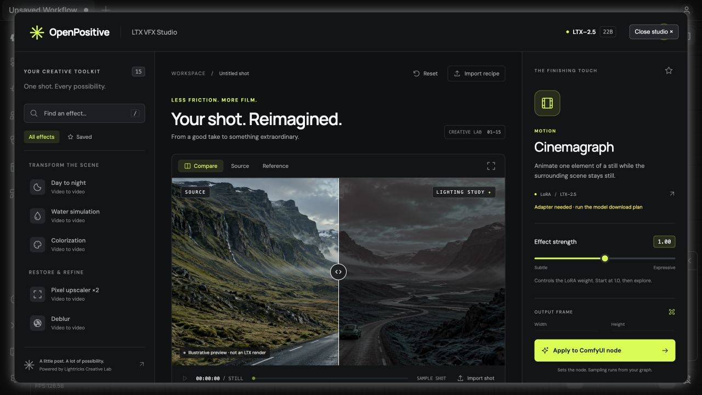

### Built on open-source work, with credit to its creators

The models and LoRAs are created by **Lightricks**. OpenPositive contributes the guided interface, effect catalog, ComfyUI integration, setup tools, and workflow companion. The underlying model research belongs to Lightricks.

- **Original LoRAs:** [LTX-2.5 Creative Lab on Hugging Face](https://huggingface.co/collections/Lightricks/ltx-25-creative-lab).
- **Base model files:** [Lightricks/LTX-2.5](https://huggingface.co/Lightricks/LTX-2.5).
- **Upstream ComfyUI integration:** [Lightricks/ComfyUI-LTXVideo](https://github.com/Lightricks/ComfyUI-LTXVideo).
- **Application runtime:** [ComfyUI](https://github.com/Comfy-Org/ComfyUI).

OpenPositive’s application code is [MIT licensed](LICENSE). Model weights retain their own upstream terms and are downloaded from their original repositories; they are not bundled or relicensed here. The included upstream workflow and fonts retain their respective licenses.

## Start here

| What you want to do | Where to go |
| --- | --- |
| Install and make your first local shot | [Get started in ComfyUI](#get-started-in-comfyui) |
| See what every LoRA can do | [Explore all 15 capabilities](#explore-all-15-lora-capabilities) |
| Try the interface before installing models | [Preview without ComfyUI](#preview-the-interface-without-comfyui) |
| Find exact model files and settings | [Model reference](docs/MODELS.md) |
| Use a hosted API or a Comfy service instead | [Optional integrations](#optional-integrations) |
| Review the competition entry requirements | [Competition guide](docs/COMPETITION.md) |

### Why use OpenPositive?

- **Start with a creative task.** Find an effect by what you want to achieve, rather than memorizing model filenames.
- **Get guidance where you need it.** The inspector explains source requirements, prompt rules, and matching workflow settings.
- **Keep the graph editable.** Apply settings to ordinary ComfyUI nodes and inspect the sampling, decoding, and output stages yourself.
- **Work locally.** The Studio UI and its bundled fonts work offline; local inference needs no hosted API once dependencies and weights are installed.
- **Learn the differences between effects.** A matte, an HDR master, and a slow-motion shot need different pipelines. The interface points you to those requirements.

A **LoRA** is a smaller adapter used alongside a base model to specialize it for a task. Most of this collection’s **IC-LoRAs** also use your source frames as a reference. Loading an adapter alone is not a complete rendering workflow.

## Get started in ComfyUI

For your first run, use **Cinemagraph**: one still image, one included starter graph, and a clearly described moving detail. You can add the other adapters later; you do not need to download the entire collection to begin.

**You will need:** a current ComfyUI installation, its Python environment, storage for the selected LTX-2.5 model files, and hardware suitable for the upstream workflow. These are large 22B model assets. This project does not claim a universal minimum VRAM size; check the model/workflow requirements for your machine.

Nothing downloads model weights or connects to LTX when you install this pack or open the Studio.

### 1. Install OpenPositive

First [install ComfyUI](https://docs.comfy.org/installation/manual_install) or update your existing installation. This package was tested with **ComfyUI 0.42.0**, frontend **1.57.1**, and ComfyUI-LTXVideo revision `220e1d45`. Older installations without the native LTX-2.5/video nodes need an update.

From your **ComfyUI folder**:

```bash
cd /path/to/ComfyUI
git clone https://github.com/jmportilla-tio-magic/ComfyUI-Open-Source-Competition.git custom_nodes/ComfyUI-Open-Source-Competition
```

Alternatively, use this repository's **Code → Download ZIP**, extract it, and put the extracted folder directly inside `ComfyUI/custom_nodes/`. Its `__init__.py` must be directly inside that folder, not another nested copy. Restart ComfyUI after installation.

The node pack itself has no extra pip dependencies. The optional model downloader and Comfy SDK runner have separate extras below. For commands using `python` or `pip`, use **the Python environment that runs your ComfyUI**; a different system Python will not install dependencies into ComfyUI. Desktop and portable installations have their own Python environments and `custom_nodes` locations.

### 2. Install Lightricks’ LTX nodes

From your ComfyUI folder, with its Python environment active:

```bash
git clone https://github.com/Lightricks/ComfyUI-LTXVideo.git custom_nodes/ComfyUI-LTXVideo
python -m pip install -r custom_nodes/ComfyUI-LTXVideo/requirements.txt
```

If this pack is already installed, update that copy and install its requirements instead of cloning it twice. Restart ComfyUI.

### 3. Download only the models you need

From **this repository's folder**, install the optional downloader and inspect a plan:

```bash
cd /path/to/ComfyUI/custom_nodes/ComfyUI-Open-Source-Competition
python -m pip install -e ".[models]"
python scripts/download_models.py --effect cinemagraph --with-base --comfy-root /path/to/ComfyUI
```

That command only lists files and destinations. To download, accept the upstream terms on Hugging Face, authenticate locally with `hf auth login` or `HF_TOKEN`, and repeat with `--download`:

```bash
python scripts/download_models.py --effect cinemagraph --with-base --comfy-root /path/to/ComfyUI --download

# Optional: every adapter and its recommended base variants.
python scripts/download_models.py --all --with-base --comfy-root /path/to/ComfyUI --download
```

The helper puts files in ComfyUI’s model folders and does not execute remote code. For manual downloads, open the [original collection](https://huggingface.co/collections/Lightricks/ltx-25-creative-lab), choose the adapter, and follow the exact filenames and destinations in [the model guide](docs/MODELS.md). Model licenses and access conditions are separate from this repository’s MIT license.

### 4. Make your first shot

1. Restart ComfyUI after adding models. Open or drag in [`examples/workflows/cinemagraph_api.json`](examples/workflows/cinemagraph_api.json). ComfyUI can import this API-format graph.
2. Choose your still in **Load Image**. Confirm the model, text encoder, and VAE dropdowns match the installed files. The included starter uses the development transformer.
3. Find **LTX VFX · Studio** and click **Open VFX Studio**, or use **Extensions → OpenPositive**. Select Cinemagraph, describe the part that should move, and click **Apply to ComfyUI node**.
4. Queue the workflow in ComfyUI. The graph loads models, prepares conditioning, samples, crops guides, decodes, and saves a silent MP4. Open the output from **Save Video** or ComfyUI's output folder.
5. To compare a finished render in the Studio, choose **Load a rendered reference**. Files imported into the Studio's viewer are local previews; choose the actual inference source in the graph's loader.

The example's node connections and native output path have been checked; a weighted LTX render is still required on your own configured hardware. For another effect, start from its matching upstream workflow and follow [workflow entry points](examples/README.md).

### What happens when you click Apply?

The Studio writes your effect, prompt, and controls to **LTX VFX · Studio** in the graph. That node prepares a model, conditioning, and latent input. The connected sampler generates the frames; guide cropping, VAE decoding, and Save Video finish the shot.

Applying settings does not automatically replace your base model or sampler. Match the recommendation shown in the inspector. The included Cinemagraph starter already provides those connections. For other effects, use [the matching workflow entry point](examples/README.md).

## Explore all 15 LoRA capabilities

Every capability below links to its **original Lightricks model card** for examples, downloads, license terms, and workflow requirements. The [Creative Lab collection](https://huggingface.co/collections/Lightricks/ltx-25-creative-lab) is the upstream source; [our model reference](docs/MODELS.md) records the filenames and settings used by this integration.

These are **local open-weights capabilities**. Most use the standard Studio preparation path; HDR and Slow motion open specialist workflow handoffs. Layout, Restore, and Refine also need their effect-specific downstream stages. All 15 adapters are available through **LTX VFX · Apply Effect** inside their matching graphs. Catalog coverage does not mean every complete pipeline has been GPU-tested.

**See the effect before you try it.** The clickable stills below are captured from **Lightricks’ original Hugging Face demos**. Click a preview or its video link to watch the original. These are upstream examples, not renders verified through OpenPositive. Full videos may require Hugging Face sign-in and acceptance of the repository’s access terms. Pixel Upscaler currently has no published demo on its model card. [Demo sources and credits](docs/demos/README.md)

### Find your task

| I want to… | Capability | Bring |
| --- | --- | --- |
| Relight a daytime shot | [Day to night](#day-to-night) | Daytime video |
| Remove moving subjects | [Clean plate](#clean-plate) | Video |
| Add water effects | [Water simulation](#water-simulation) | Video |
| Make a clean shot larger | [Pixel upscaler ×2](#pixel-upscaler-2) | Low-resolution video |
| Improve defocused footage | [Deblur](#deblur) | Defocused video |
| Clean compression artifacts | [Decompression](#decompression) | Compressed video |
| Add color to monochrome footage | [Colorization](#colorization) | Monochrome video |
| Animate part of a photograph | [Cinemagraph](#cinemagraph) | One still |
| Generate slow-motion action | [Slow motion](#slow-motion) | One still |
| Guide a scene with references | [Ingredients](#ingredients) | Reference sheet |
| Create an HDR master | [SDR to HDR](#sdr-to-hdr) | SDR video |
| Finish a 3D playblast | [Layout to render](#layout-to-render) | Layout video + finished still |
| Refine fine texture | [Refine details](#refine-details) | Video |
| Restore archive footage | [Restore archive](#restore-archive) | Archive video |
| Extract a foreground matte | [Alpha matte](#alpha-matte) | RGB video |

### Day to night

**Daytime video → a night-time version of the shot.** Relight an exterior while using the original camera and subject motion as a guide.

**Try it:** Start with a clearly exposed daytime shot and describe the intended night lighting, such as cool moonlight and warm windows.

**Keep in mind:** Resample your source to 24 fps and follow the recommended development-model sampling recipe. This is a whole-frame transformation, without a region mask.

[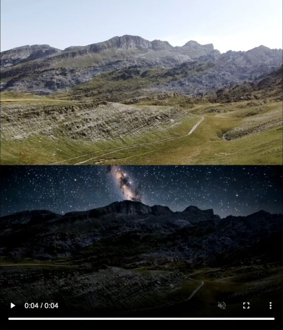](https://huggingface.co/Lightricks/LTX-2.5-22b-IC-LoRA-Day-To-Night)

**Original demo:** [▶ Watch Day to night — Lightricks’ video](https://huggingface.co/Lightricks/LTX-2.5-22b-IC-LoRA-Day-To-Night/resolve/main/examples/Examples_6__step_003000_02.mp4) · [Open the original model card](https://huggingface.co/Lightricks/LTX-2.5-22b-IC-LoRA-Day-To-Night)

[Original model, examples, and downloads on Hugging Face](https://huggingface.co/Lightricks/LTX-2.5-22b-IC-LoRA-Day-To-Night)

### Clean plate

**Video with moving subjects → a reconstructed background plate.** Prepare a background for compositing by removing moving people or objects.

**Try it:** Choose a shot where enough background is visible around the moving subjects to guide reconstruction.

**Keep in mind:** This is full-frame removal, not a brush-based object eraser. Inspect reconstructed areas before compositing; the upstream example may require an audio track or silence.

[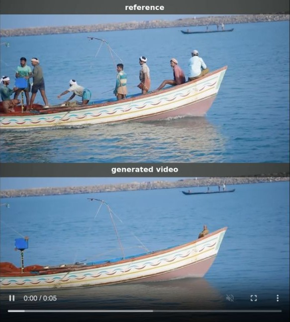](https://huggingface.co/Lightricks/LTX-2.5-22b-IC-LoRA-Clean-Plate)

**Original demo:** [▶ Watch Clean plate — Lightricks’ video](https://huggingface.co/Lightricks/LTX-2.5-22b-IC-LoRA-Clean-Plate/resolve/main/examples/clean_plate_001_output_sbs.mp4) · [Open the original model card](https://huggingface.co/Lightricks/LTX-2.5-22b-IC-LoRA-Clean-Plate)

[Original model, examples, and downloads on Hugging Face](https://huggingface.co/Lightricks/LTX-2.5-22b-IC-LoRA-Clean-Plate)

### Water simulation

**Source video → a version with generated water effects.** Add flowing water, rain, spray, or flooding to a scene.

**Try it:** Use the `ADD WATER` trigger and describe where the water comes from and how it moves.

**Keep in mind:** Use native-resolution, stage-1 sampling with reference conditioning retained throughout. Increasing strength too far can distort faces and fine detail.

[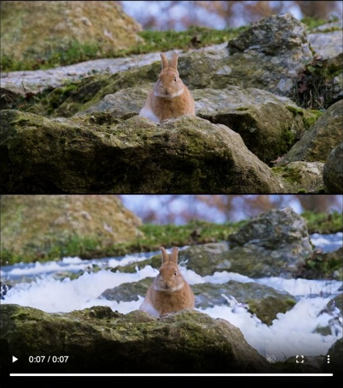](https://huggingface.co/Lightricks/LTX-2.5-22b-IC-LoRA-Water-Simulation)

**Original demo:** [▶ Watch Water simulation — Lightricks’ video](https://huggingface.co/Lightricks/LTX-2.5-22b-IC-LoRA-Water-Simulation/resolve/main/examples/rabbit_forest_sbs.mp4) · [Open the original model card](https://huggingface.co/Lightricks/LTX-2.5-22b-IC-LoRA-Water-Simulation)

[Original model, examples, and downloads on Hugging Face](https://huggingface.co/Lightricks/LTX-2.5-22b-IC-LoRA-Water-Simulation)

### Pixel upscaler ×2

**Clean low-resolution video → twice the width and height.** Create a larger version of a shot with synthesized texture and fine detail.

**Try it:** Keep the original aspect ratio and supply a reference at half the target width and height.

**Keep in mind:** This is a creative upscaler: added detail is generated, not recovered evidence. Use its matching reference-scale settings.

**Original demo:** Lightricks’ current model card does not include a visual example for this adapter. See the original model card below for its workflow and intended use.

[Original model, examples, and downloads on Hugging Face](https://huggingface.co/Lightricks/LTX-2.5-22b-IC-LoRA-Pixel-Spatial-Upscaler)

### Deblur

**Softly focused video → a sharper interpretation.** Improve footage affected by defocus.

**Try it:** Include `DEBLUR` and describe the same scene. Reduce adapter strength if halos or excessive sharpening appear.

**Keep in mind:** The adapter targets defocus rather than motion blur. For identity-sensitive footage, follow the native-resolution stage-1 workflow and inspect the result closely.

[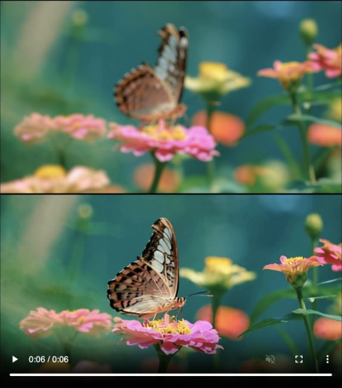](https://huggingface.co/Lightricks/LTX-2.5-22b-IC-LoRA-Deblur)

**Original demo:** [▶ Watch Deblur — Lightricks’ video](https://huggingface.co/Lightricks/LTX-2.5-22b-IC-LoRA-Deblur/resolve/main/examples/Examples_4__00_15485932_sbs.mp4) · [Open the original model card](https://huggingface.co/Lightricks/LTX-2.5-22b-IC-LoRA-Deblur)

[Original model, examples, and downloads on Hugging Face](https://huggingface.co/Lightricks/LTX-2.5-22b-IC-LoRA-Deblur)

### Decompression

**Compressed video → cleaner edges and color transitions.** Reduce blockiness, ringing, banding, and color bleed from compression.

**Try it:** Use `ENHANCE QUALITY` while describing the scene without asking for new content.

**Keep in mind:** Choose this for compression artifacts rather than general blur or noise. Preserve the reference in the stage-1 workflow.

[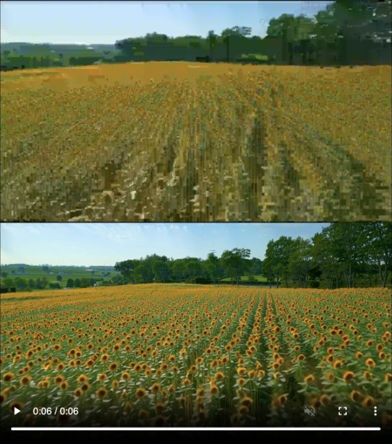](https://huggingface.co/Lightricks/LTX-2.5-22b-IC-LoRA-Decompression)

**Original demo:** [▶ Watch Decompression — Lightricks’ video](https://huggingface.co/Lightricks/LTX-2.5-22b-IC-LoRA-Decompression/resolve/main/examples/Examples_2__27_sunflower_field_sbs.mp4) · [Open the original model card](https://huggingface.co/Lightricks/LTX-2.5-22b-IC-LoRA-Decompression)

[Original model, examples, and downloads on Hugging Face](https://huggingface.co/Lightricks/LTX-2.5-22b-IC-LoRA-Decompression)

### Colorization

**Monochrome video → a plausible colored interpretation.** Explore a palette for black-and-white footage.

**Try it:** Use `COLORIZE` and specify colors for important clothing, surfaces, or scenery while keeping the same composition.

**Keep in mind:** Colors are inferred. They are not proof of the source’s historical colors.

[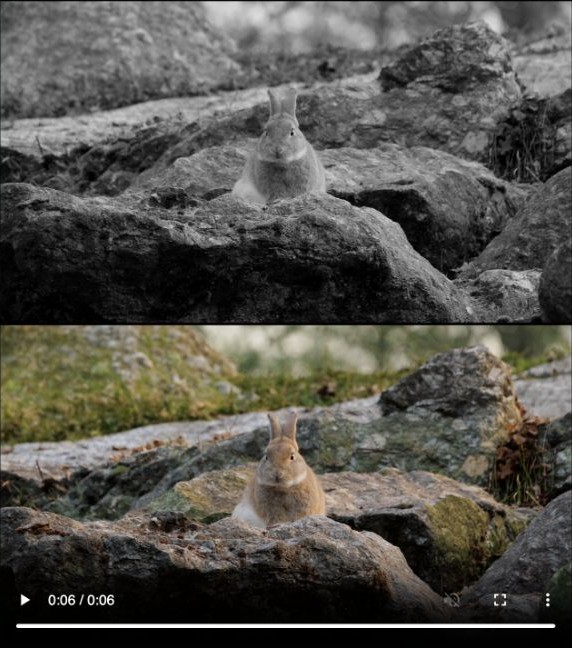](https://huggingface.co/Lightricks/LTX-2.5-22b-IC-LoRA-Colorization)

**Original demo:** [▶ Watch Colorization — Lightricks’ video](https://huggingface.co/Lightricks/LTX-2.5-22b-IC-LoRA-Colorization/resolve/main/examples/Examples_5__00_rabbit_rocks_sbs.mp4) · [Open the original model card](https://huggingface.co/Lightricks/LTX-2.5-22b-IC-LoRA-Colorization)

[Original model, examples, and downloads on Hugging Face](https://huggingface.co/Lightricks/LTX-2.5-22b-IC-LoRA-Colorization)

### Cinemagraph

**One still image → a short shot with selected motion.** Animate water, steam, foliage, or another small detail while the rest of the image stays still.

**Try it:** Start with the [included Cinemagraph workflow](examples/workflows/cinemagraph_api.json). Example brief: `CINEMAGRAPH_MOTION, locked camera. Only the water ripples; the buildings and shoreline stay frozen.`

**Keep in mind:** Use a still, not a video batch. Describe both what moves and what remains frozen. The supplied starter uses the development transformer; camera moves and complex body motion are outside the intended use.

[](https://huggingface.co/Lightricks/LTX-2.5-22b-LoRA-Cinemagraph)

**Original demo:** [▶ Watch Cinemagraph — Lightricks’ video](https://huggingface.co/Lightricks/LTX-2.5-22b-LoRA-Cinemagraph/resolve/main/examples/Glasses_LTX_2.3_i2v_00272_.mp4) · [Open the original model card](https://huggingface.co/Lightricks/LTX-2.5-22b-LoRA-Cinemagraph)

[Original model, examples, and downloads on Hugging Face](https://huggingface.co/Lightricks/LTX-2.5-22b-LoRA-Cinemagraph)

### Slow motion

**One still image → newly generated slow-motion action.** Explore the timing of an action while keeping video playback at 24 fps.

**Try it:** Use the official dual-rate workflow and its speed control. The upstream example starts at speed 0.2 for 5× slow motion.

**Keep in mind:** This generates motion from an image; it does not slow down an existing clip. **Dedicated workflow required.** Fetch the gated workflow using the downloader’s `--workflows` option after accepting its terms.

[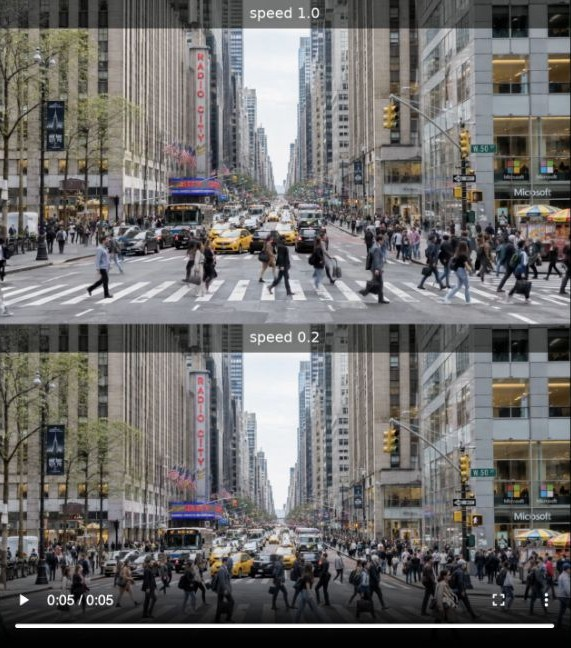](https://huggingface.co/Lightricks/LTX-2.5-22b-LoRA-Slow-Motion-Control)

**Original demo:** [▶ Watch Slow motion — Lightricks’ video](https://huggingface.co/Lightricks/LTX-2.5-22b-LoRA-Slow-Motion-Control/resolve/main/examples/ny_street_sbs.mp4) · [Open the original model card](https://huggingface.co/Lightricks/LTX-2.5-22b-LoRA-Slow-Motion-Control)

[Original model, examples, and downloads on Hugging Face](https://huggingface.co/Lightricks/LTX-2.5-22b-LoRA-Slow-Motion-Control)

### Ingredients

**A reference sheet → a shot guided by its characters, props, and location.** Bring several visual references together to guide a new scene.

**Try it:** Arrange clean panels on black without text, then describe the reference elements and the action you want.

**Keep in mind:** The graph repeats one sheet as a static reference for at least 121 frames. Elements absent from the sheet are not identity-controlled.

[](https://huggingface.co/Lightricks/LTX-2.5-22b-IC-LoRA-Ingredients)

**Original demo:** [▶ Watch Ingredients — Lightricks’ video](https://huggingface.co/Lightricks/LTX-2.5-22b-IC-LoRA-Ingredients/resolve/main/examples/ingredients_lora_1.mp4) · [Open the original model card](https://huggingface.co/Lightricks/LTX-2.5-22b-IC-LoRA-Ingredients)

[Original model, examples, and downloads on Hugging Face](https://huggingface.co/Lightricks/LTX-2.5-22b-IC-LoRA-Ingredients)

### SDR to HDR

**SDR video → color-managed HDR deliverables.** Finish footage through the upstream ACES-aware HDR pipeline.

**Try it:** Open the [included official HDR workflow](examples/workflows/sdr-to-hdr.json) and resolve its model files and scene embeddings.

**Keep in mind:** **Dedicated workflow required.** Scene embeddings, color transforms, and HDR export are essential. An ordinary 8-bit MP4 or brighter preview is not an HDR master.

[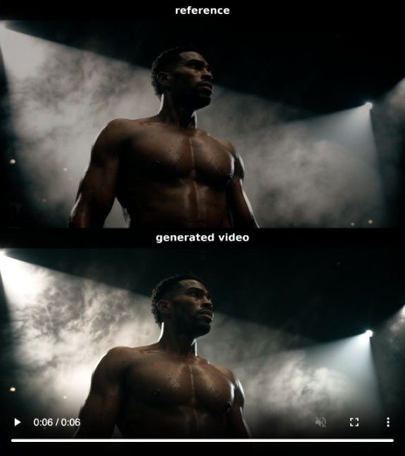](https://huggingface.co/Lightricks/LTX-2.5-22b-IC-LoRA-SDR-To-HDR)

**Original demo:** [▶ Watch SDR to HDR — Lightricks’ video](https://huggingface.co/Lightricks/LTX-2.5-22b-IC-LoRA-SDR-To-HDR/resolve/main/examples/sdr-to-hdr-boxing_sbs.mp4) · [Open the original model card](https://huggingface.co/Lightricks/LTX-2.5-22b-IC-LoRA-SDR-To-HDR)

[Original model, examples, and downloads on Hugging Face](https://huggingface.co/Lightricks/LTX-2.5-22b-IC-LoRA-SDR-To-HDR)

### Layout to render

**A 3D playblast plus an art-directed first frame → a finished interpretation.** Guide a shot’s camera and object placement with layout footage, and its appearance with a finished still.

**Try it:** Connect the layout video as `source` and the art-directed still as `first_frame`. Describe the intended materials, lighting, and scene.

**Keep in mind:** Both inputs are required. Use the official two-stage workflow; Studio prepares the first-stage conditioning, and the second stage must keep the adapter and appropriate guides active.

[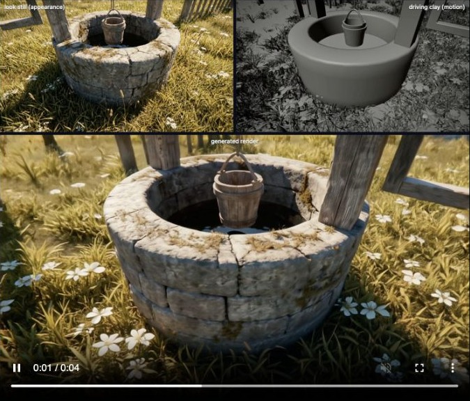](https://huggingface.co/Lightricks/LTX-2.5-22b-IC-LoRA-Layout-To-Render)

**Original demo:** [▶ Watch Layout to render — Lightricks’ video](https://huggingface.co/Lightricks/LTX-2.5-22b-IC-LoRA-Layout-To-Render/resolve/main/examples/summer.mp4) · [Open the original model card](https://huggingface.co/Lightricks/LTX-2.5-22b-IC-LoRA-Layout-To-Render)

[Original model, examples, and downloads on Hugging Face](https://huggingface.co/Lightricks/LTX-2.5-22b-IC-LoRA-Layout-To-Render)

### Refine details

**Video → a pass that rebuilds texture and fine edges.** Refine an existing shot’s photographic detail.

**Try it:** Resize the source guide to the intended output canvas and describe the scene’s natural textures.

**Keep in mind:** Use the matching spatial tiled sampler when larger than one tile. Studio’s temporal guide encoding alone does not perform spatial tiled sampling. For archive footage, restore first, then refine.

[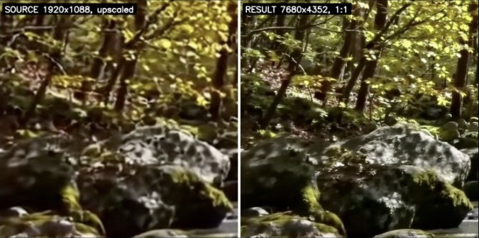](https://huggingface.co/Lightricks/LTX-2.5-22b-IC-LoRA-Refine-Details)

**Original demo:** [▶ Watch Refine details — Lightricks’ video](https://huggingface.co/Lightricks/LTX-2.5-22b-IC-LoRA-Refine-Details/resolve/main/examples/refine_forest_stream_crop.mp4) · [Open the original model card](https://huggingface.co/Lightricks/LTX-2.5-22b-IC-LoRA-Refine-Details)

[Original model, examples, and downloads on Hugging Face](https://huggingface.co/Lightricks/LTX-2.5-22b-IC-LoRA-Refine-Details)

### Restore archive

**Damaged archive video → a restored interpretation.** Address damaged footage while guiding texture, scene appearance, and plausible color.

**Try it:** Deinterlace first. Describe the period, setting, clothing, and materials, and inspect any newly generated detail.

**Keep in mind:** Do not pre-sharpen or pre-denoise. Use the dedicated tiled restoration setup and preserve aspect ratio. Generated reconstruction and color are not historical evidence.

[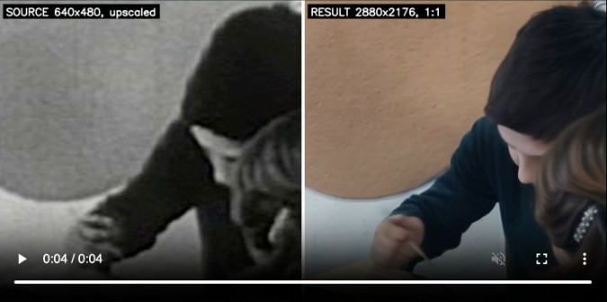](https://huggingface.co/Lightricks/LTX-2.5-22b-IC-LoRA-Restore)

**Original demo:** [▶ Watch Restore archive — Lightricks’ video](https://huggingface.co/Lightricks/LTX-2.5-22b-IC-LoRA-Restore/resolve/main/examples/restore_family_meal_1954_crop.mp4) · [Open the original model card](https://huggingface.co/Lightricks/LTX-2.5-22b-IC-LoRA-Restore)

[Original model, examples, and downloads on Hugging Face](https://huggingface.co/Lightricks/LTX-2.5-22b-IC-LoRA-Restore)

### Alpha matte

**RGB video → a grayscale foreground matte.** Create a compositing matte to combine with the original color footage.

**Try it:** Leave the positive prompt empty; the model predicts the foreground automatically.

**Keep in mind:** The output is a grayscale matte, not an RGBA video. Use native-resolution stage-1 inference, stay within the 145-frame limit, and combine the matte with the source in your compositor.

[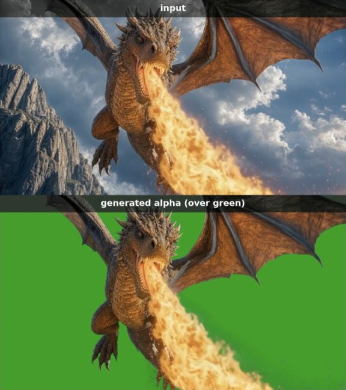](https://huggingface.co/Lightricks/LTX-2.5-22b-IC-LoRA-Alpha-Gen)

**Original demo:** [▶ Watch Alpha matte — Lightricks’ video](https://huggingface.co/Lightricks/LTX-2.5-22b-IC-LoRA-Alpha-Gen/resolve/main/examples/dragon_fire_sbs.mp4) · [Open the original model card](https://huggingface.co/Lightricks/LTX-2.5-22b-IC-LoRA-Alpha-Gen)

[Original model, examples, and downloads on Hugging Face](https://huggingface.co/Lightricks/LTX-2.5-22b-IC-LoRA-Alpha-Gen)

## Preview the interface without ComfyUI

Requires Python 3.10+. From this repository:

```bash
python3 scripts/preview.py
```

Open **http://127.0.0.1:8765**. Search/favorite effects, preview local media, edit controls, and import/export validated recipes. Press `/` to search or `⌘/Ctrl + Enter` to apply/export. No accounts, GPU, models, or Node build step are needed.

This is a design/recipe preview and does not generate video. Its sample comparison is an **illustrative lighting study, not an LTX render**. Local viewer files stay in the browser.

## Optional integrations

**You can skip this section for the local Creative Lab experience.** These integrations are alternatives for running or transporting workflows, rather than requirements for the open-source VFX tools.

The hosted LTX API node supports text/image generation separately. It does **not** expose the 15 Creative Lab adapters through its public generation schema. Use the local model route for the capabilities above. [Hosted route details](docs/LTX-API.md)

### Hosted generation with your own LTX key

This route needs **no local LTX model downloads or ComfyUI-LTXVideo installation**. It uses this package and current ComfyUI's video support.

1. Obtain a key through [LTX's API page](https://ltx.io/model/api).
2. Set `LTX_API_KEY` in the environment of the process that starts ComfyUI, then start or restart ComfyUI from that environment. `LTXV_API_KEY` is accepted as an alias. Use your OS/environment or deployment's secret manager; there is no API-key widget and keys must not go in a workflow or frontend file.
3. Open the text or image starter linked in [the LTX API guide](docs/LTX-API.md), or add **OpenPositive → LTX API → LTX API · Generate** and connect its `VIDEO` output to **Save Video**.
4. Set the prompt, model, supported resolution, duration, and frame rate. For image-to-video, connect **Load Image** to `image`.
5. When you are ready to send that request to LTX, enable **allow_api_requests** and queue it. The node submits once, polls the job, downloads the MP4, and returns a native ComfyUI `VIDEO` plus its job ID. Hosted requests use your LTX account and may incur charges.

`render_id` identifies an intentional new request; it is **not a model seed**. Keep it unchanged to retrieve the same recorded request, and change it deliberately for a new generation. The guide explains saved job state, timeouts, recovery, supported combinations, and the distinction from Comfy's built-in Partner Nodes. No API call or credential check was performed while preparing this repository.

### Run your open-source graph as a Comfy service

A Comfy service executes the **same complete graph**. Install this node pack on the server/worker, along with either its local model dependencies or its server-side LTX key. Then export the working graph using **Save (API Format)**. A `.ltx-vfx.json` Studio recipe contains settings only and is not a service workflow.

For a company workspace, package the environment as a [Comfy API Build](https://comfy.org/platform/). For a local v2 service, run the official `comfy-api-proxy` beside ComfyUI. The [platform guide](docs/PLATFORM.md) covers both and explains which runtime dependencies belong in the Build.

From this repository, install the official SDK helper and validate an image-input graph without connecting to anything:

```bash
python -m pip install -e ".[platform]"
python scripts/platform_run.py examples/workflows/cinemagraph_api.json \
  --asset your-still.png --input-node 10 --input-name image --output-node 90 \
  --validate-only
```

When you configure your endpoint, set `COMFY_BASE_URL` and, where required, `COMFY_API_KEY` in the runner's environment. Remove `--validate-only` and add a unique `--state .ltx-vfx-jobs/shot-001.json` for each intended render. Reusing that state resumes the same job. For another graph, use its actual loader/save node IDs. Hosted LTX graphs also need their request switch enabled deliberately before service execution.

**These credentials serve different purposes:** `COMFY_API_KEY` authenticates the runner to Comfy; `LTX_API_KEY` authenticates the optional hosted node from inside the worker to LTX. Local open-weights inference does not need an LTX API key. The SDK does not install custom nodes or make the Creative Lab adapters available through Comfy Router.

## Troubleshooting

| Symptom | What to check |
| --- | --- |
| OpenPositive nodes are missing | Verify the folder sits directly under `custom_nodes`, restart ComfyUI, and read its startup import errors. |
| Native LTX/video nodes are missing | Update ComfyUI. For local effects, install/update ComfyUI-LTXVideo in the same environment. |
| A model is absent from a dropdown | Check the exact filename/folder in [MODELS.md](docs/MODELS.md), then restart or refresh ComfyUI's model list. |
| The standalone preview does not render | It is a settings/preview UI. Run a complete workflow inside ComfyUI. |
| A Studio selection does not alter a connected control | A graph connection owns that input; edit/disconnect it in ComfyUI before applying a widget value. |
| Hosted API requests are disabled or the key is missing | Enable the switch only when ready; set the key in the actual ComfyUI process environment and restart. |
| Hosted request times out after submission | Preserve its job ID/state and follow the recovery guide; do not create another request just to check status. |
| A service rejects the graph | Export API format, install its node dependencies on the worker, and use actual loader/output IDs. |

## Verification and contribution

```bash
python3 -m unittest discover -s tests -v
node --test tests/*.test.mjs
node --check web/studio.js
node --check web/extension.js
```

Python contract tests and API transport tests use controlled stand-ins and do not require network, keys, torch, or weights. Node 22+ is sufficient for the JavaScript checks. GitHub Actions runs these checks and builds the package.

For an already installed ComfyUI/LTXVideo environment, the separate CPU integration check is:

```bash
/path/to/comfy/python tests/comfy_integration.py --comfy-root /path/to/ComfyUI
```

It checks actual pack registration, native tensor preparation/cropping for 13 standard paths, two specialist guards, starter graph schemas, and native MP4 encoding/decoding. Model weights, text embeddings, and the VAE encoder are substituted. The live ComfyUI browser's Studio open/apply/API-export flow also passed. [Versions and evidence](docs/NATIVE-NODES.md)

**Validation boundary:** no weighted LTX inference, live LTX API request, company Build, or authenticated service render has been executed here. The code and setup paths are prepared; validate a real shot in the environment you choose before claiming a completed demo.

## Open-source competition

OpenPositive is being prepared as an open-source ComfyUI competition entry. Its contribution is making Lightricks’ VFX adapters easier to discover, understand, configure, and reproduce in inspectable workflows. The models themselves remain Lightricks’ work.

For someone trying or reviewing the project:

1. Follow [Get started](#get-started-in-comfyui) for the local, open-weights route.
2. Use the included Cinemagraph graph for a first shot, then explore another capability with its upstream workflow.
3. Inspect the ordinary ComfyUI nodes, effect catalog, source-linked documentation, and [validation record](docs/NATIVE-NODES.md).
4. Reproduce the exact input, graph, model versions, and settings used for the submitted demo.

The [competition guide](docs/COMPETITION.md) tracks the published rules, category distinctions, and remaining submission evidence. A real working demo is still required; the interface’s illustrative sample is not model-inference evidence. The optional hosted API route is separate from the open-weights demonstration.

### Contribute and share what works

[Open an issue](https://github.com/jmportilla-tio-magic/ComfyUI-Open-Source-Competition/issues) with the effect, ComfyUI/LTXVideo versions, exact model filenames, graph, and a description of the result. Share rights-cleared inputs and remove keys or private paths from logs. Improvements to installation guidance, validated workflows, accessibility, and effect-specific tips are welcome.

### Credits and licenses

Thank you to [Lightricks](https://huggingface.co/Lightricks), the [ComfyUI contributors](https://github.com/Comfy-Org/ComfyUI), and the creators who publish workflows and model documentation.

- **OpenPositive application code:** [MIT license](LICENSE).
- **Original models and adapters:** [LTX-2.5](https://huggingface.co/Lightricks/LTX-2.5) and [Creative Lab](https://huggingface.co/collections/Lightricks/ltx-25-creative-lab); their own licenses and access terms apply.
- **Bundled upstream workflow:** [LTXVideo license](examples/workflows/LTXVideo.LICENSE) and [source record](examples/workflows/sdr-to-hdr.source.json).
- **Bundled fonts:** [font credits and SIL Open Font Licenses](web/fonts/README.md).
- **Preview image:** [asset provenance](web/assets/README.md); an illustrative asset, not an LTX-generated result.
